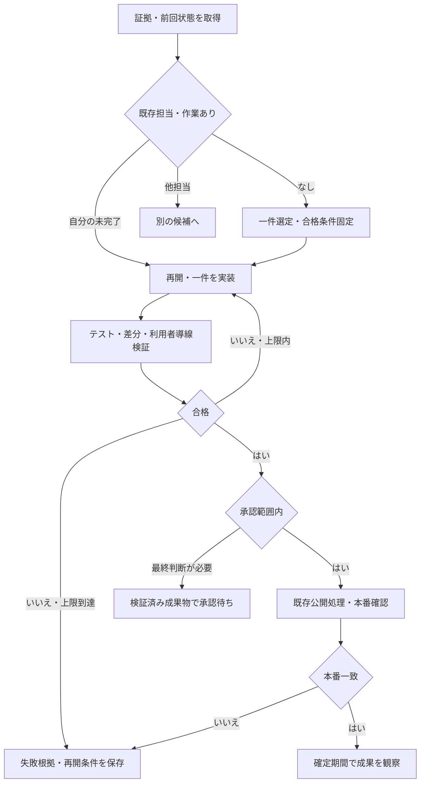

# CEO 運用グラフ
更新日: 2026-11-10 JST

## 目的と適用
オーナーは最終判断、AIは調査・実装・検証・引継ぎを担う。既存の承認範囲・ブランド別ルールを維持する。これは既存エージェントが実行する運用仕様であり、新しい常駐実行エンジンではない。保存だけで自走の動作確認済みとはしない。
参考: https://www.anthropic.com/research/building-effective-agents 、https://www.anthropic.com/research/effective-harnesses-for-long-running-agents
複雑な新規フレームワーク・従量課金API・重複スケジュールを導入しない。

## 起動と担当
- CEO実行者: 既存ChatGPT「57hustler 集客改善の自走」。起動時に本書、main、AGENTS.md、CLAUDE.md、事業別ルール、直近PR/Actions、前回記録を読む。
- Claude: docs/claude-task-handoff.md を維持。claude-task / claude-in-progress と claude/ ブランチはClaude専任、Draft PRまで。他実行者は触らない。
- 既存監視は検知担当。検知・Issue起票・設定保存は修正成功ではない。
- 優先順: 承認済み投稿の停止・期限切れ等の収益阻害 → 楽旅 → レンズ → ペット。MITAMA・夜中のおじさんは既存の個別承認範囲で継続・品質改善。note/Ko-fiは購入まで区別して評価。雑草おじさんの保留は解除しない。

## 状態遷移（条件を満たしたときだけ進む）


## 各工程の契約
| 工程 | 入力 | 出力 | 不合格条件 |
|---|---|---|---|
| 取得 | 最新main・実ログ・前回記録 | 日時/期間/URL付き根拠 | 未取得を0にする、過去報告を現況扱い |
| 選定 | 根拠・既存担当 | 一件の問題、対象、合格条件、戻し方 | 競合、未再現、承認外 |
| 実装 | 固定した合格条件 | 最小差分とPR | 対象外変更、新規課金、保護機構を弱める |
| 検証 | 差分・合格条件 | 対象SHA付きテスト/CI/導線結果 | lint/buildだけで利用者導線も成功とする |
| 公開判断 | 検証済み成果物 | 既存承認による公開又は最終承認待ち | 未検証、権限不足、承認範囲外 |
| 公開確認 | 公開SHA/URL/投稿履歴 | 全対象の内容一致・投稿ID確認 | HTTP200だけ、想定外アカウント、部分成功 |
| 効果確認 | 同期間の分母/送客/売上 | 比較結果と次の仮説 | クリックを売上にする、因果を断定 |

## 上限・失敗・引継ぎ
- 一回の変更は全事業合計最大一件。既存の観察待ちには新しい改善を重ねない。
- 修正は一回の実行で最大3巡。同じ失敗を根拠なく再試行しない。実行環境の上限が先なら途中保存。待ち続けず、CI等の次に確認する対象を残す。
- 新規課金0。外部モデルAPI・有料サービスを新たに有効化しない。
- 投稿の応答不明・部分成功は自動再送禁止。公開状態、投稿ID、永続履歴を照合してから判断する。
- 検証を通すための合格条件緩和、重複防止/品質/認証ガード解除は禁止。
- 作業の既存IssueまたはPR本文へ次の状態を記録（同じ作業の新Issueを乱造しない）。既存禁止ルールでコメントできなければ自分の最終結果へ残す。
```json
{
  "task": "既存Issue/PRのURL",
  "owner": "CEOまたはClaude",
  "status": "observing",
  "commit_sha": "対象SHA",
  "evidence": [{"url": "証拠URL", "checked_at": "ISO8601", "result": "実取得結果"}],
  "acceptance": ["実装前に固定した合格条件"],
  "attempts_this_run": 0,
  "checks": [{"name": "対象チェック", "result": "pass/fail/not_run", "evidence": "ログURL等"}],
  "next_action": "次に確認・実行する具体的な一手",
  "resume_when": "CI完了/次の承認済み投稿枠/確定7日到来等",
  "rollback": "戻す対象と手順",
  "owner_decision": null
}
```
status は queued / implementing / verifying / awaiting_approval / publishing / observing / blocked / done のいずれか。設定保存・PR作成だけでdoneにしない。修正公開済みでも効果判定は別に残す。次回実行は最新GitHubと照合して再開。秘密値・個人情報は保存しない。

## 最終承認の扱い
- すでに許可された小さく可逆な楽旅UI改善は、必要な検証後、既存の公開処理と本番確認まで進める。毎回GOを求めない。
- 未承認の送客先/価格算式/計測範囲/認証/権限/決済/noindex/新規課金/大きな変更は、成果物・検証結果・影響・戻し方を先に揃えて最終判断だけ求める。
- 投稿継続の個別承認は日次タスクの既存指示を参照。同じ頻度での承認済み継続と新規投稿方式・頻度増を混同しない。写真投稿PR #181は既存の未有効化状態を維持し、承認済みと推定しない。
- 独立レビューは実際に別の検証者が実施した場合だけ記載。自己レビューを独立と呼ばない。
- 完了報告は「実行変更/証拠/未確認/本人の最終判断」のみ簡潔に。常時稼働・収益保証をうたわない。

## 初回の再開対象
2026-11-10の既存日次結果では投稿遅延修正はmain反映済み、実投稿ID確認は未完了。PR #192と最新Actionsを再取得して確認する。本書だけから復旧済みとしない。
ClaudeのPR #191（Issue #190）は専任範囲として維持。
MITAMAは日本語の語義説明への偏りを現状データと原稿から確認し、既存コンセプトに照らして改善案を検証。夜中のおじさんも反応の低下を実測せず断定しない。
